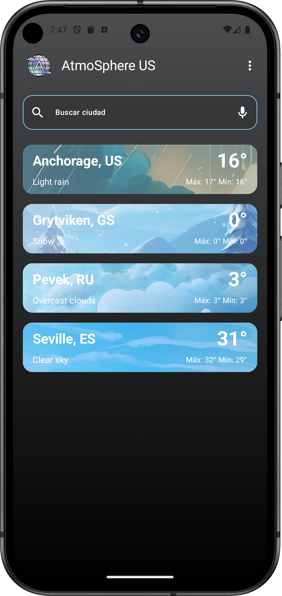
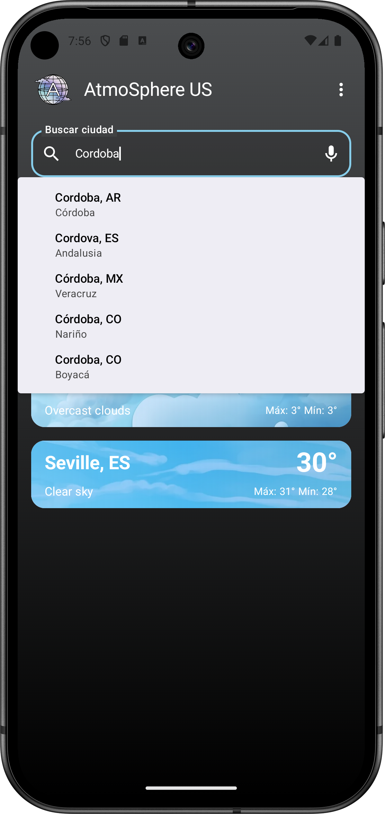
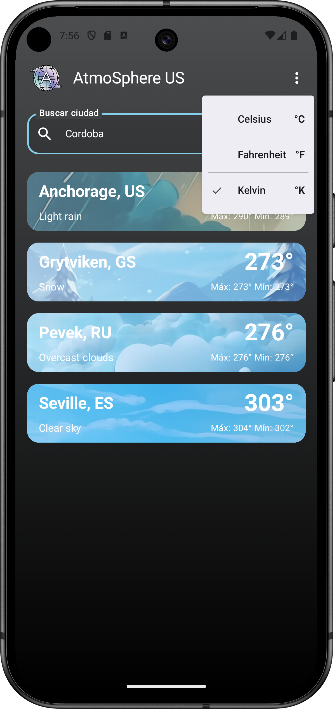
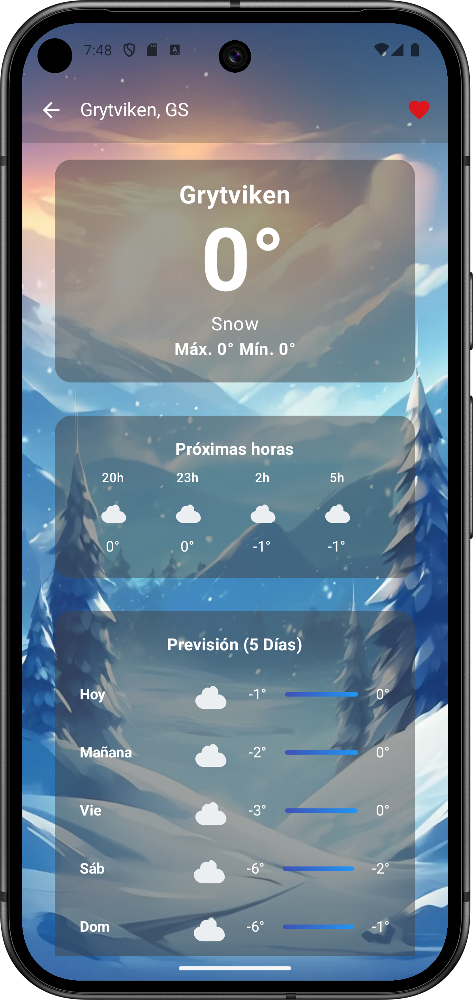
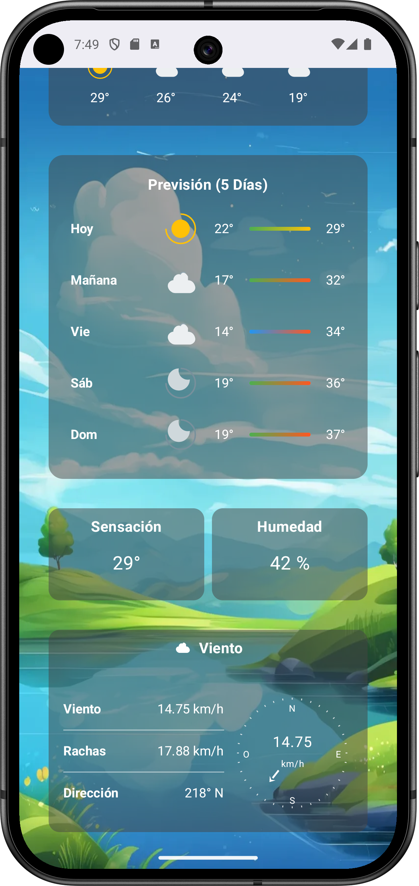

# AtmoSphere 🌤️

Una aplicación moderna de clima desarrollada con Kotlin y Jetpack Compose que ofrece información meteorológica en tiempo real con animaciones dinámicas y una interfaz de usuario intuitiva.

## 📱 Características

- **Búsqueda de ciudades**: Busca cualquier ciudad del mundo por texto o voz
- **Búsqueda por voz**: Integración con reconocimiento de voz para búsquedas manos libres
- **Información detallada del clima**: Temperatura actual, sensación térmica, humedad, viento
- **Pronóstico por horas**: Vista de las próximas horas del día
- **Pronóstico de 5 días**: Previsión extendida con temperaturas mínimas y máximas
- **Ciudades favoritas**: Gestiona tu lista personalizada de ciudades
- **Múltiples unidades**: Celsius, Fahrenheit y Kelvin
- **Animaciones dinámicas**: Fondos animados que cambian según las condiciones meteorológicas
- **Diseño Material 3**: Interfaz moderna siguiendo las últimas guías de Material Design

## 🛠️ Tecnologías Utilizadas

### Core
- **Kotlin** - Lenguaje de programación principal
- **Jetpack Compose** - Framework moderno para UI declarativa
- **Material 3** - Sistema de diseño de Google
- **MVVM Pattern** - Arquitectura de presentación

### Networking
- **Retrofit** - Cliente HTTP para API REST
- **Kotlinx Serialization** - Serialización JSON nativa de Kotlin
- **OpenWeatherMap API** - Fuente de datos meteorológicos

### Navigation & State
- **Navigation Compose** - Navegación entre pantallas
- **StateFlow** - Manejo reactivo del estado
- **Compose State** - Estado local de UI

### Location & Permissions
- **Google Play Services Location** - Detección de ubicación
- **Android Permissions** - Manejo de permisos de ubicación y micrófono

### UI/UX
- **Coil** - Carga de imágenes
- **Custom Animations** - Transiciones y efectos personalizados

### Build System & Architecture
- **Gradle Version Catalogs** - Gestión centralizada de dependencias en `libs.versions.toml`
- **Build Logic** - Plugins de convención personalizados para estandarizar configuración
- **Multi-Module Architecture** - Separación completa por funcionalidades y responsabilidades
- **Domain Layer** - Módulo de dominio independiente con casos de uso y entidades

## 📋 Requisitos Previos

- Android Studio Hedgehog | 2023.1.1 o superior
- JDK 11 o superior
- Android SDK con nivel de API mínimo 24 (Android 7.0)
- Clave API de OpenWeatherMap

## 🔧 Configuración del Proyecto

### 1. Clonar el repositorio
```bash
git clone https://github.com/tu-usuario/AtmoSphere.git
cd AtmoSphere
```

### 2. Obtener API Key de OpenWeatherMap
1. Ve a [OpenWeatherMap](https://openweathermap.org/api)
2. Regístrate o inicia sesión
3. Ve a "API keys" en tu perfil
4. Genera una nueva API key (gratis)

### 3. Configurar la API Key
Crea un archivo `local.properties` en la raíz del proyecto (si no existe) y añade tu API key:

```properties
OW_API_KEY=tu_api_key_aqui
```

## 📱 Cómo usar la aplicación

1. **Primera vez**: La app solicitará permisos de ubicación para detectar tu región automáticamente
2. **Buscar ciudades**:
    - Escribe el nombre de una ciudad en el campo de búsqueda
    - O presiona el ícono del micrófono para búsqueda por voz
3. **Ver detalles**: Toca cualquier ciudad para ver información detallada
4. **Gestionar favoritos**:
    - Desliza hacia la izquierda para eliminar ciudades
    - Toca el corazón en la vista de detalles para marcar como favorita
5. **Cambiar unidades**: Toca el menú (⋮) en la pantalla principal para cambiar entre °C, °F y °K

## 🏗️ Arquitectura

El proyecto sigue la arquitectura **MVVM (Model-View-ViewModel)** recomendada por Google y está **completamente modularizado por features** para mejorar la escalabilidad, mantenibilidad y tiempo de compilación:

### Estructura del proyecto:
```
AtmoSphere/
├── app/                           # Módulo principal de la aplicación
├── build-logic/                   # Plugins de convención y lógica de build
├── domain/                        # Módulo de dominio (casos de uso, entidades)
├── feature/                       # Módulos de funcionalidades
│   ├── home/                      # Pantalla principal y lista de ciudades
│   ├── detail/                    # Detalles del clima de una ciudad
│   └── search/                    # Funcionalidad de búsqueda
├── framework/                     # Framework y utilidades base
├── gradle/                        # Configuración de Gradle
│   ├── libs.versions.toml         # Version Catalog (gestión de dependencias)
│   └── wrapper/                   # Gradle Wrapper
├── test/unit/                     # Tests unitarios compartidos
├── build.gradle.kts              # Configuración raíz del proyecto
├── settings.gradle.kts           # Configuración de módulos del proyecto
├── gradle.properties             # Propiedades de Gradle
├── gradlew / gradlew.bat         # Scripts del Gradle Wrapper
└── .gitignore                    # Archivos ignorados por Git
```

### Características arquitecturales:
- **Separación completa por módulos**: Cada funcionalidad en su propio módulo
- **Módulo de dominio**: Lógica de negocio centralizada e independiente del framework
- **Build logic personalizada**: Plugins de convención para estandarizar configuración
- **Framework modular**: Utilidades y componentes base compartidos
- **Testing modular**: Tests unitarios organizados por módulos

### Beneficios de la modularización:
- **Compilación paralela**: Múltiples módulos se compilan simultáneamente
- **Reutilización de código**: Componentes compartidos entre features
- **Separación de responsabilidades**: Cada módulo tiene una responsabilidad específica
- **Testing aislado**: Cada feature puede ser probado independientemente
- **Desarrollo en equipo**: Diferentes desarrolladores pueden trabajar en módulos separados

### Build System:
- **Build Logic**: Plugins de convención personalizados en el módulo `build-logic`
- **Gradle Version Catalogs**: Dependencias centralizadas en `libs.versions.toml`
- **Kotlin DSL**: Build scripts con tipado fuerte y mejor soporte del IDE
- **Gradle Wrapper**: Garantiza la misma versión de Gradle en todo el equipo

### Flujo de datos:
1. **UI** → **ViewModel** → **Repository** → **API Service**
2. Los datos fluyen de vuelta usando **StateFlow**
3. La UI se recompone automáticamente cuando cambia el estado

## 🎨 Capturas de pantalla

<div style="text-align: center;">

### Pantalla Principal y Lista de Ciudades


### Búsqueda de ciudades


### Selector de unidades


### Detalles del Clima (Descripción, Próximas Horas, Previsión 5 Días)


### Detalles del Clima (Sensación, Humedad y Viento)


</div>

### 📱 Vista en grid de funcionalidades

<div style="text-align: center;">

|                         Pantalla Principal                          |                                 Búsqueda                                  |                                 Unidades                                 |
|:-------------------------------------------------------------------:|:-------------------------------------------------------------------------:|:------------------------------------------------------------------------:|
|  |  |  |

|                              Detalles Clima                               |                              Viento y Datos                               |
|:-------------------------------------------------------------------------:|:-------------------------------------------------------------------------:|
|  |  |

</div>


## 🚀 Funcionalidades destacadas

### Animaciones dinámicas
- Fondos que cambian según el clima (soleado, nublado, lluvia, tormenta, nieve)
- Transiciones suaves entre pantallas
- Efectos de carga (shimmer) elegantes

### Búsqueda inteligente
- Autocompletado basado en la API de OpenWeather
- Manejo de errores con mensajes informativos
- Búsqueda por voz en múltiples idiomas

### Gestión de estado robusto
- Estado persistente durante rotaciones de pantalla
- Manejo elegante de errores de red
- Estados de carga optimizados

## 🧪 Testing

El proyecto incluye tests unitarios e instrumentales:

```bash
# Ejecutar tests unitarios
./gradlew test

# Ejecutar tests instrumentales
./gradlew connectedAndroidTest
```

## 📝 Licencia

Este proyecto está bajo la Licencia MIT. Ver `LICENSE` para más detalles.

## 👨‍💻 Autor

**Roberto Muñoz**
- GitHub: [@robertomr99](https://github.com/robertomr99)
- Proyecto desarrollado como parte del programa Architect Coders

---

⭐ Si te gusta el proyecto, ¡dale una estrella en GitHub!